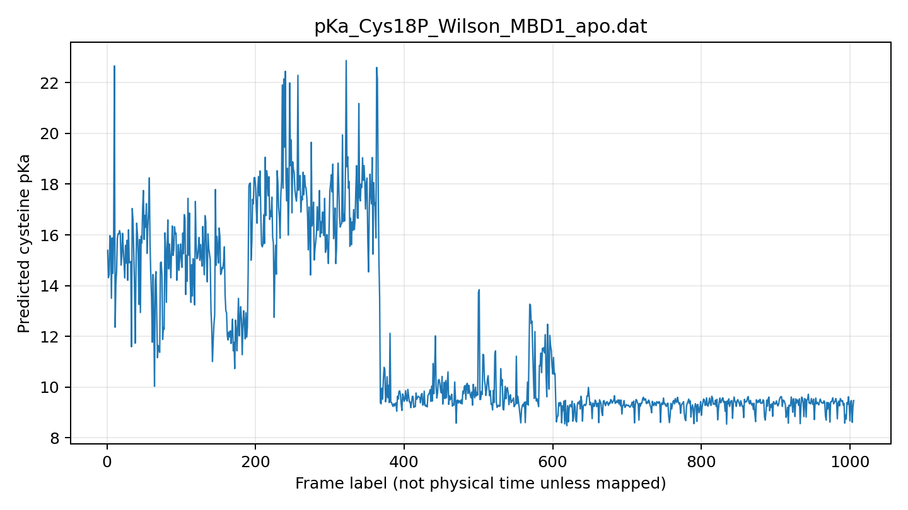
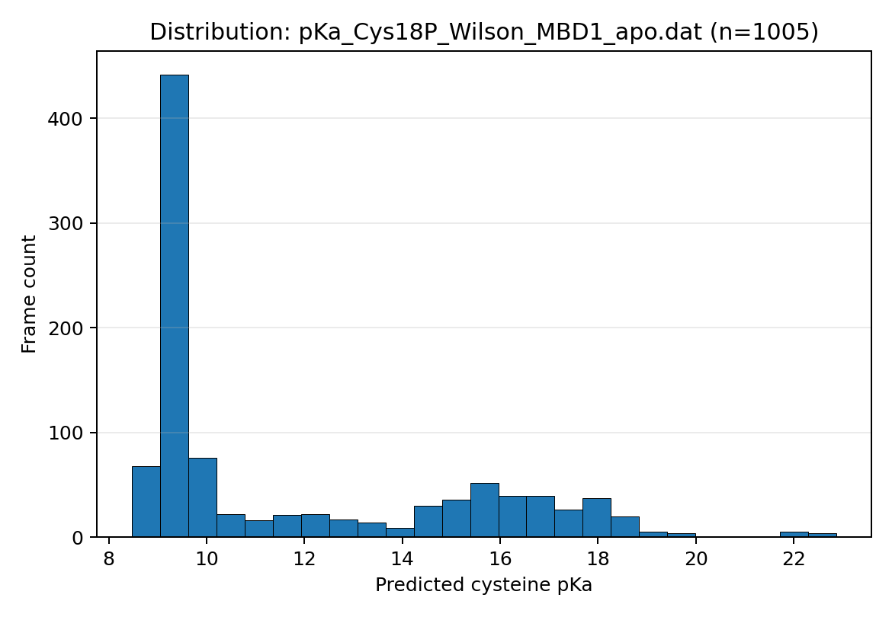

# Cysteine Protonation Analysis

**Version 0.1.0 · Python · PROPKA output analysis · MDAnalysis (optional)**

A reproducible toolkit for analyzing cysteine pKa estimates across MD-derived structures, comparing apo/complex states, extracting cysteine pKa records from PROPKA reports, and characterizing the local environment around a cysteine sulfur atom.

This repository was assembled from the supplied `propKa_cys.zip` and the Wilson MBD1/MBD2/MBD3 apo archives. It replaces duplicated histogram and neighbor scripts with parameterized commands, retains curated original result files with SHA-256 provenance, and documents limitations where original topology/trajectory files were absent.

## Scope

- Read and validate frame-labelled, two-column pKa series (`frame_label pKa`).
- Summarize pKa distributions and compare multiple series in one CSV.
- Cross-check terminal pKa values against the colocated `out.pka` report to flag likely alternate-run or provenance mismatches.
- Generate a frame trace and histogram without hardcoded sample counts or output names.
- Extract primary cysteine pKa rows from a PROPKA `.pka` report.
- Run an installed PROPKA executable on PDB snapshots exported from a trajectory, storing each run independently.
- Calculate periodic-boundary-aware atom contacts around an explicitly selected cysteine atom (normally `SG`) using MDAnalysis.
- Keep accompanying cysteine–cysteine distance traces for optional structural context, with frame-alignment cautions in the data manifest.

## Installation

Python 3.10 or newer is recommended.

```bash
python -m venv .venv
source .venv/bin/activate          # Linux/macOS
python -m pip install -e ".[analysis,test]"
pytest
```

The core pKa reader, statistics, plotting, and PROPKA text parser use NumPy and Matplotlib. MDAnalysis is optional unless you run the `neighbors` command or need trajectory support. PROPKA itself and VMD are separate external programs and are not installed by this package.

## Quick start

Summarize one pKa series:

```bash
cpa summarize data/raw/propka_series/Human/Wilsons1/pKa_Cys18P_Wilson_MBD1_apo.dat --ph 7.0
```

Generate the frame trace and histogram:

```bash
cpa plot data/raw/propka_series/Human/Wilsons1/pKa_Cys18P_Wilson_MBD1_apo.dat \
  --output-prefix outputs/wilson_mbd1_cys18
```

Summarize every curated pKa dataset listed in the manifest:

```bash
cpa compare --manifest data/manifest.csv --ph 7.0 --output outputs/pka_summary.csv
```

Audit whether each pKa series' final value matches its mirrored `out.pka` report:

```bash
cpa audit-terminal --output outputs/terminal_report_consistency.csv
```

The checked-in [`data/terminal_frame_pka_report_check.csv`](data/terminal_frame_pka_report_check.csv) records this audit for the current curated snapshot.

Extract primary CYS predictions from a saved PROPKA report:

```bash
cpa parse-report data/raw/propka_reports/Human/Wilsons1/out.pka \
  --output outputs/wilson_mbd1_report_cys.csv
```

Export trajectory frames in VMD and calculate pKa values on the resulting PDB snapshots (see [`scripts/README.md`](scripts/README.md)):

```bash
cpa trajectory-propka pka_frames --executable propka3 \
  --resid 18 --chain P --output-dir outputs/wilson_mbd1_propka
```

Calculate neighbors within 4 Å of the sulfur atom of a cysteine:

```bash
cpa neighbors --topology system.psf --trajectory trajectory.dcd \
  --segid P --resid 18 --atom SG --cutoff 4.0 \
  --output outputs/cys18_sg_contacts.csv
```

If residue numbers are reused between chains/segments, pass `--segid` (for NAMD/PSF-style topology files) or `--chain` (when chain IDs are provided by the topology) to disambiguate. Contact distances are in Å. Periodic boundary handling uses the current frame's box when it has valid dimensions; otherwise the calculation is non-periodic. The CSV includes `partner_resindex` so two different residues with the same segment/residue labels are not accidentally conflated.

## Interpreting the results correctly

**The first column is a frame label, not time.** Most archived trajectory extraction Tcl scripts wrote `[frame index + 1]` in the first column. Do not relabel these values as ns or ps without confirming saved-frame stride, timestep, and the exact trajectory mapping. The companion cysteine-pair distance data start at frame index 0; alignment between distance and pKa traces must be established explicitly before correlations are calculated.

The `--ph` summaries include the fraction of frames whose *predicted pKa* is below the selected pH and a Henderson–Hasselbalch mapping of each frame's pKa to an idealized thiolate fraction. These are model-derived descriptors, **not direct measurements of protonation populations**. Framewise predictions are correlated, and the usual per-frame standard deviation is not a standard error or confidence interval. A large shift in predicted pKa is a useful signal for inspection, not proof of a proton-transfer mechanism.

The historical PROPKA reports included here identify themselves as version 3.0 and contain a warning that this version does not work with ligands. Current PROPKA documentation describes protein–ligand calculations, but that does not guarantee that a particular copper coordination model is parameterized or represented correctly. In particular, the archived VMD workflows write `protein` atoms only, which omits Cu and other non-protein atoms. Such outputs must not be presented as explicit metal-aware pKa estimates. See [`docs/methodology.md`](docs/methodology.md).

## Example from the curated data

The following plots are generated from the Wilson MBD1 Cys18 framewise PROPKA series with the unified plotting code. The x-axis is deliberately a frame label, not a guessed time axis.





These example plots show a clear shift in the trace and a broad/multimodal distribution. This is a reason to inspect the original structural trajectory and frame mapping—not evidence by itself for a specific conformational mechanism. The summary statistics intentionally do not collapse this into a claim of one equilibrated pKa population.

## Included research-derived data

- `data/raw/propka_series/`: 44 two-column data files from the supplied archive. Forty have at least 200 rows and are catalogued as `framewise_candidate`; four have only five rows and are retained as `short_series_unclassified` rather than assumed to be trajectories.
- `data/raw/propka_reports/`: original `.pka` report text for provenance and parser tests.
- `data/reference/cysteine_pair_distances/`: one distinct cysteine–cysteine distance trace for each of Wilson MBD1, MBD2, and MBD3. One byte-identical MBD2 duplicate from the source archive was not duplicated.
- `data/manifest.csv`, `data/propka_reports_manifest.csv`, and `data/cysteine_pair_distances_manifest.csv`: source archive/member names, dimensions, frame-label notes, and file hashes.
- `data/terminal_frame_pka_report_check.csv`: terminal-row consistency audit against mirrored PROPKA reports.

The structures, topology files, complete trajectories, and force-field files needed to reproduce all historical calculations are not included. Source data summaries are included for code examples and analysis, but should not be treated as an independent validation of the original simulations.

## Repository map

```text
src/cysteine_protonation_analysis/  # maintainable package and CLI
scripts/export_frames.tcl           # configurable VMD frame export
scripts/README.md                   # external PROPKA workflow
data/raw/propka_series/              # curated original pKa series
data/raw/propka_reports/             # original PROPKA reports
data/reference/                      # supporting cysteine-pair distance traces
docs/                                # methodology, source audit, workflow catalog
tests/                                # parser, statistics, CLI, PBC, and runner tests
```

## Status

The code is tested with synthetic data and the curated pKa files are format-validated. The trajectory neighbor module is tested using a synthetic MDAnalysis universe including a boundary-crossing contact. The per-frame PROPKA orchestration is tested using a mock executable. The real historical topologies, trajectories, VMD, and PROPKA installations were not available for end-to-end scientific reproduction.

Before public release, choose a license, confirm that any distributed result files may be shared, test the snapshot workflow against the actual structure/trajectory, and record the PROPKA version and structure preparation choices for any new results.
